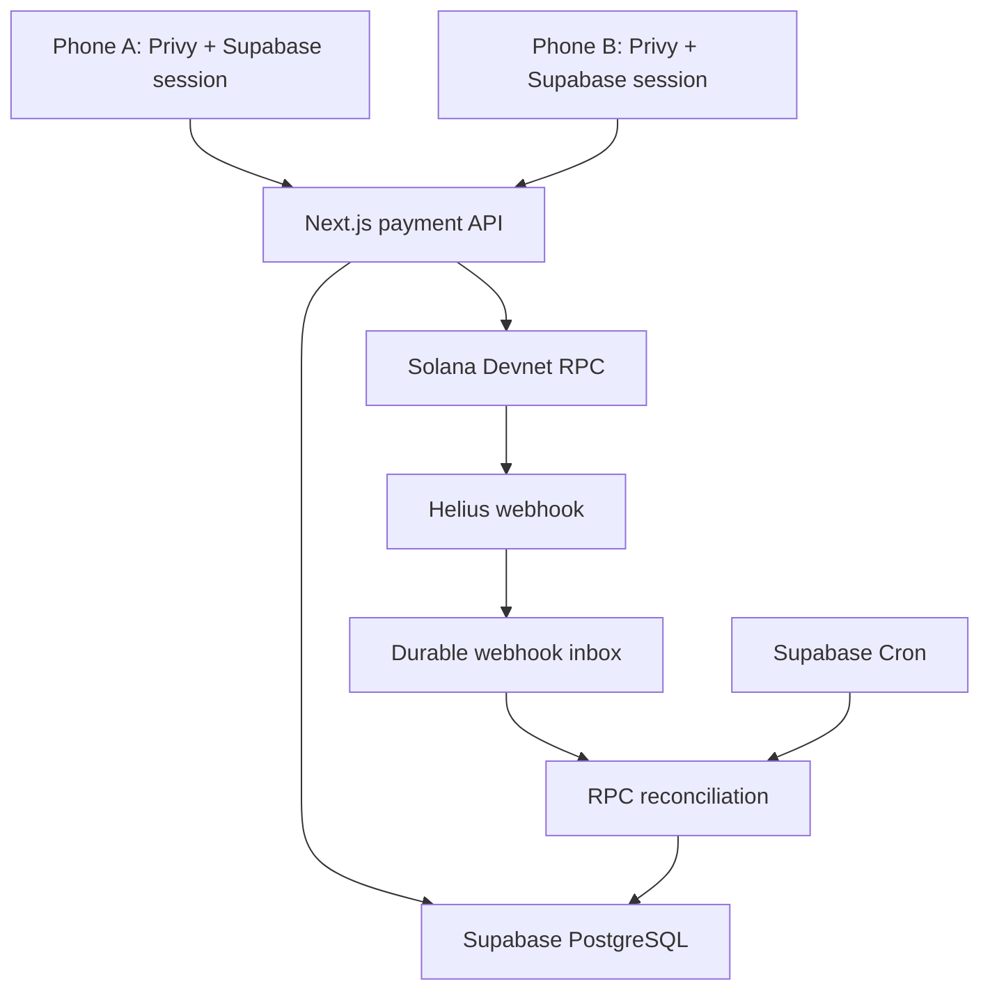

# Ihsan Payments Lab

Two isolated browser clients use the same Next.js TypeScript backend and Supabase PostgreSQL database. Each account has its own Privy embedded Solana wallet. An application-owned fee payer sponsors the transaction; the user signs the transfer in their browser. A funded test treasury provides Circle devnet USDC.

## Start here


```bash
cp .env.example .env.local
npm ci
# Fill environment, apply supabase/migrations/001_initial.sql, configure Privy.
npm run wallet:create
npm run seed
npm run setup:check
npm run dev
```

Runtime: Node.js 22.12+ (24 LTS recommended). Package versions are locked in `package-lock.json`. `PRIVY_APP_SECRET` is not required by this design; all user-wallet signing is client-side. Do not copy secrets into source files.

## Implemented

- Username/password registration with Supabase Auth, immutable username-to-wallet mapping and signed wallet ownership challenge.
- Official Privy custom JWT authentication using Supabase asymmetric Auth signing keys.
- Per-user embedded Solana wallets and user-authorized signatures. No server-side user-wallet signer or delegated wallet access.
- Two isolated phone documents with independent authentication, chat, profile, funding and activity tabs.
- Realtime chat through Supabase Realtime with participant RLS; payment and balance snapshots refresh on an eight-second fallback interval.
- Test-USDC treasury grants; per-account daily limits and database-backed IP/request limits.
- Integer token amounts, serialized outgoing reservations, idempotent payment preparation and immutable transaction messages.
- Fee and associated token-account rent sponsorship by a separate application keypair.
- Durable signed-transaction storage **before** broadcast. Uncertain submissions retry the exact bytes/signature.
- Authenticated Helius devnet webhook inbox, post-response verification, and independent scheduled reconciliation.
- Finalized RPC transaction/message verification before accounting, terminal failure/expiry states.
- Exactly two balanced append-only journal entries per finalized payment.
- Receipt detail with addresses, signature, slot, timestamps and devnet explorer link.
- Wallet export through Privy's own UI. Private keys are not returned to the application.
- Curated, read-only public observability view; it deliberately exposes only this demo's public accounts/payments, never messages, passwords or service keys.

## Architecture



Payment lifecycle:

`draft → prepared → submitted → finalized`

`prepared/submitted → expired` only after the finalized block height passes the stored validity height plus a 32-block safety margin **and** repeat signature/transaction lookups are absent. A finalized chain rejection leads to `failed`. An abandoned unsigned draft can expire after five minutes. There is intentionally no “cancel already broadcast” endpoint.

### Fixed transaction identity

The sponsor signs first during preparation. Because the sponsor is the fee payer, its signature is the network transaction ID. That signature and serialized transaction are committed with compare-and-set before the bytes are handed to the client. A racing preparation cannot return its losing transaction. The client signs the stored message. Submission rejects missing signatures or any change to recipients, amount, instructions, fee payer or blockhash. The same intent is never silently rebuilt after an ambiguous broadcast.

Client idempotency identifies a payment **intent**. Deliberately creating a new intent represents a new payment; the application cannot infer that two intentional payments were a mistake.

### Webhooks are hints, not settlement authority

The Helius auth header is constant-time compared with a server secret. Events are validated, size/batch limited and deduplicated by transaction signature. Accepted events are stored before acknowledgment. `after()` starts a bounded verification pass; the cron job handles missed/failed callbacks and incomplete submissions. A webhook cannot credit funds merely by claiming an amount or success. Only a finalized RPC transaction matching the stored message can call SQL settlement.

`received_at` records first receipt; repeated callbacks do not reset the event or post another journal. Untracked signatures are marked `untracked`. This implementation reconciles **application-created payments and faucet grants**. It is not a general-purpose external-deposit indexer; external token transfers can affect the observed balance without appearing as an app receipt/journal entry.

### Two clients, one deployment

Privy persists browser authentication by origin. Two providers inside same-origin divs are not an adequate isolation boundary. The left iframe therefore uses a second hostname/alias for the same application. Locally use `localhost:3000` and `127.0.0.1:3000`; on Vercel use two stable public aliases/deployments with matching environment variables. Both are allowed in Privy and the application's frame-ancestor/origin rules. No additional VPS is required. Open the phones separately if the browser blocks a wallet flow inside an iframe.

The shared host account is deliberately publicly accessible when enabled. It contains only test tokens. Guests' sessions are in memory and do not persist through a reload; they can sign in again. Privy's own SDK manages its separate encrypted wallet/auth state.

## API

All user endpoints use `Authorization: Bearer <Supabase access token>`. JSON mutations additionally require an allowlisted browser Origin. Webhooks/jobs use their own secrets. Mobile applications can use the same business endpoints after adding an explicit mobile-client origin/auth policy; do not remove the browser-origin check globally.

| Endpoint | Method | Purpose |
| --- | --- | --- |
| `/api/auth/register` | POST | Username, password, optional displayName |
| `/api/auth/login` | POST | Username/password login |
| `/api/auth/demo` | POST | Opt-in shared host session |
| `/api/snapshot` | GET | Current profile, contacts, messages, receipts, on-chain balance |
| `/api/wallet/challenge` | POST | Short-lived per-account ownership challenge |
| `/api/wallet/bind` | POST | Verify Ed25519 challenge signature; bind once |
| `/api/messages` | POST | Participant message with client UUID |
| `/api/payments/prepare` | POST | Reserve amount and persist a sponsored transaction |
| `/api/payments/submit` | POST | Verify signed message; persist before broadcast |
| `/api/payments/reconcile` | POST | Rate-limited check of caller's pending payments |
| `/api/faucet` | POST | Idempotent capped grant of test USDC |
| `/api/webhooks/helius` | POST | Raw/enhanced devnet transaction notifications |
| `/api/jobs/reconcile` | POST | Secret-authenticated scheduled reconciliation |
| `/api/system` | GET | Curated public demo observability, read-only |

Example prepare body: `{"recipientId":"<UUID>","amount":"5","key":"<UUID>"}`. Amounts travel as strings; arithmetic uses bigint and six decimal base units. The API returns a transaction for the user's wallet to sign, **not** a user private key.

## Validation

```bash
npm run typecheck
npm test
npm run build
```

Tests cover amount precision/rejection, transaction message tampering/missing signatures, webhook normalization, and real PostgreSQL invariants via PGlite. SQL tests execute the migration's tables, constraints and functions; only Supabase platform publication/extension setup is stubbed. They verify duplicate intents, mismatched idempotency requests, outgoing reservations, faucet limits, duplicate settlement, balanced entries and ledger immutability. They do not substitute for testing live Supabase Auth/Realtime, Privy, Helius or Solana.

## Intentional boundaries

- This is a reviewable development implementation, not an independently audited payment product.
- No bank rails, KYC/KYB, card issuing, merchant checkout or full messenger implementation. No fake “bank deposits” or KYC approvals.
- No custom smart contract is necessary for ordinary SPL transfers. No token creation or DeFi integration.
- Authentication uses synthetic demo email aliases, so email recovery is not available. A production identity/recovery design must replace this.
- Supabase custom JWT auth is an identity trust root. Avoiding raw key storage and delegated server signers does **not** prove the operator cannot impersonate a user if that root is compromised. Independently enforced user recovery/MFA and a reviewed Privy policy configuration are required before claiming that stronger security property. Wallet recovery must be exercised separately; this code includes export, not an independently verified recovery guarantee.
- A DB superuser can change the database despite application-level immutability; use access separation and external audit retention in production.
- RPC availability, devnet resets, faucet supply and free-service quotas can interrupt this prototype. A cron interval is eventual recovery, not a settlement SLA. The reconciliation batch is intentionally capped at 12 payments.
- Web UI integration is implemented; there is no React Native build in this source package. A native client would share the API and use Privy's React Native SDK for signing.
- This demo's public system view intentionally publishes pseudonymous wallet/payment data. Replace its access policy before using personal data.
- Server keys only control the sponsor/test treasury. They must contain devnet-only keys and stay outside source control. The network genesis guard refuses mainnet.

## References

- https://docs.privy.io/recipes/authentication/using-supabase-for-custom-auth
- https://docs.privy.io/authentication/user-authentication/jwt-based-auth/usage
- https://docs.privy.io/wallets/using-wallets/solana/sign-a-transaction
- https://solana.com/docs/references/clusters
- https://developers.circle.com/stablecoins/quickstart-transfer-10-usdc-on-solana
- https://www.helius.dev/docs/webhooks
- https://supabase.com/docs/guides/functions/schedule-functions
- https://vercel.com/docs/functions/configuring-functions/duration
# ihsan-pay

