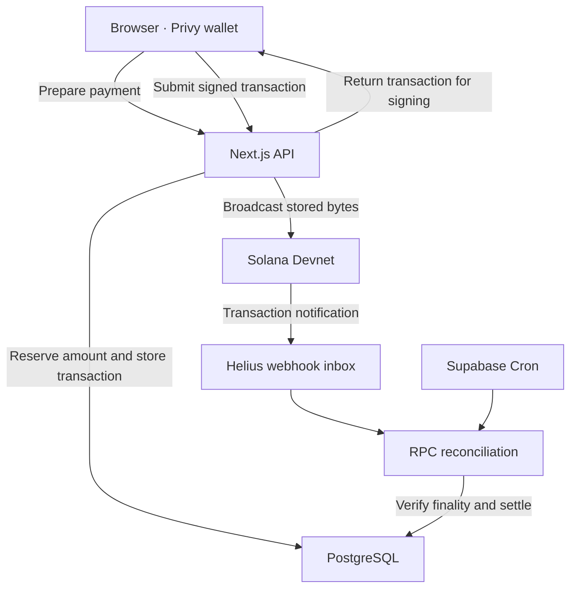

# Ihsan Payments Lab

A working reference implementation of messaging and wallet payments on Solana Devnet. Two browser clients share a Next.js backend while keeping separate Supabase sessions and Privy embedded wallets.

Users can register, send messages, request test USDC and transfer it to another username inside a conversation. The application sponsors network fees; the user's wallet signs the transfer.

[Open the application](https://ihsan-pay-lab.vercel.app/)

## Try it

Open the application on desktop to see both phones side by side.

1. Create an account on the right phone. Wallet setup starts automatically; approve the ownership request if prompted.
2. Open **Profile** and select **Add 3 test USDC**. Wait for the balance to update.
3. Open **Chats**, choose the existing account and send a message. It appears on the left phone.
4. Send **1 USDC** from the conversation and approve the transaction.
5. Open **Activity** to inspect the receipt, transaction status and explorer link.

The system tab provides a read-only view of accounts, payments, webhook events and reconciliation runs. All funds in this application are test tokens.

## Stack

| Layer | Technology |
| --- | --- |
| Application and API | Next.js, TypeScript |
| Database and authentication | Supabase PostgreSQL, Auth, Realtime |
| Embedded wallets | Privy with Supabase JWT authentication |
| Transfers | Solana Devnet, Circle test USDC |
| Transaction notifications | Helius webhooks |
| Scheduled reconciliation | Supabase Cron |
| Hosting | Vercel |

## Payment flow



### Preparation and signing

A payment starts with a client-generated idempotency key. PostgreSQL reserves the outgoing amount so concurrent requests cannot spend the same available balance through the application.

The sponsor signs the prepared transaction first. Its fee-payer signature fixes the transaction ID before the transaction reaches the user's wallet. Preparation uses a conditional database update so competing requests return the stored transaction.

The user signs that transaction in the browser. On submission, the backend verifies the signatures and checks that the transaction message matches the prepared message, including the recipient, amount, instructions, fee payer and blockhash. Signed bytes are stored before broadcast. Retries send the same bytes with the same transaction ID.

### Confirmation and accounting

Helius notifications are authenticated, deduplicated and stored before acknowledgment. They trigger reconciliation; settlement depends on a finalized RPC transaction matching the stored message. Supabase Cron also checks pending payments when a callback is delayed or missed.

Each finalized payment produces two balanced, append-only ledger entries. Repeated settlement requests do not create additional entries.

The normal payment lifecycle is:

```text
draft → prepared → submitted → finalized
```

Finalized chain errors mark a payment as `failed`. A prepared or submitted transaction can become `expired` after its validity window passes, with a 32-block safety margin and repeated checks for an on-chain result. Abandoned unsigned drafts expire after five minutes.

## Local setup

Requires **Node.js 22.12 or newer**. Dependencies are pinned in `package-lock.json`.

```bash
npm ci
cp .env.example .env.local
```

Configure the values in `.env.local`, apply `supabase/migrations/001_initial.sql` and set up Privy's Supabase JWT authentication. Then run:

```bash
npm run wallet:create
npm run seed
npm run setup:check
npm run dev
```

The wallet script generates the sponsor and test treasury keypairs. Add those values to your environment and fund the addresses on Devnet before running the setup check. Never commit `.env.local` or keypair secrets. `PRIVY_APP_SECRET` is not used by this implementation; user-wallet signing happens in the client.

See [KURULUM.tr.md](KURULUM.tr.md) for the full setup walkthrough, including provider configuration, webhook registration and the cron job.

### Browser session isolation

The phones use different origins because Privy stores browser authentication by origin. Locally, use `localhost:3000` and `127.0.0.1:3000`. On Vercel, use two stable hostnames pointing to the same deployment. Allow both origins in Privy and the application's origin and frame policies.

Guest Supabase sessions are held in memory, so guests sign in again after a reload. The optional shared host account is public and should hold test tokens only.

## API

Account endpoints require a Supabase bearer token. Browser POST requests also require an allowed `Origin`. Authentication endpoints establish the session; webhooks and scheduled jobs use separate secrets.

| Method | Endpoint | Description |
| --- | --- | --- |
| POST | `/api/auth/register` | Create an account |
| POST | `/api/auth/login` | Sign in |
| POST | `/api/auth/demo` | Open the shared host session when enabled |
| GET | `/api/snapshot` | Profile, contacts, messages, payments and balance |
| POST | `/api/wallet/challenge` | Request a wallet ownership challenge |
| POST | `/api/wallet/bind` | Verify the challenge signature and bind the wallet |
| POST | `/api/messages` | Send a message |
| POST | `/api/payments/prepare` | Reserve funds and prepare a sponsored transfer |
| POST | `/api/payments/submit` | Validate and submit the signed transaction |
| POST | `/api/payments/reconcile` | Check the caller's pending payments |
| POST | `/api/faucet` | Request a rate-limited test USDC grant |
| POST | `/api/webhooks/helius` | Receive transaction notifications |
| POST | `/api/jobs/reconcile` | Run scheduled reconciliation |
| GET | `/api/system` | Read public test activity |

Example payment preparation request:

```json
{
  "recipientId": "<recipient UUID>",
  "amount": "1",
  "key": "<request UUID>"
}
```

Amounts are strings in API requests and integer base units internally, with six decimal places for USDC. The response contains the transaction for the wallet to sign.

## Tests

```bash
npm run typecheck
npm test
npm run build
```

The test suite covers amount precision, transaction tampering, missing signatures, webhook normalization and payment recovery. Database tests use PGlite to execute the migration's PostgreSQL tables, constraints and functions, with Supabase-specific platform setup stubbed.

Database cases include duplicate requests, conflicting idempotency keys, concurrent outgoing reservations, faucet limits, repeated settlement and ledger immutability. Live provider configuration and browser wallet flows need separate integration testing. See [docs/VALIDATION.md](docs/VALIDATION.md) for the recorded validation scope.

## Scope and operational notes

- **Devnet only.** The network guard rejects mainnet. Sponsor and treasury keys must be dedicated test keys.
- **Application payments only.** Reconciliation tracks transfers and faucet grants created here. External deposits can change the observed balance without generating an application receipt or ledger entry.
- **Wallet security.** User private keys are not stored in the application database, and the backend has no delegated user-wallet signer. Supabase JWT authentication remains an identity trust root. Recovery, MFA and provider policies need separate review before a production launch. Wallet export uses Privy's UI.
- **Public test data.** The system view exposes usernames, wallet addresses and payment activity. Messages and credentials are excluded. Production deployments would need a different access policy.
- **Prototype limits.** There are no bank rails, KYC/KYB, cards, Token-2022 issuance or React Native client in this repository. Synthetic email aliases do not support email recovery. The application has not undergone an independent security audit.
- **Operations.** Reconciliation handles up to 12 pending payments per batch. Devnet availability, provider quotas and treasury funding affect service availability. Database immutability rules do not protect against a database superuser.

## Documentation

- [Setup guide](KURULUM.tr.md)
- [Validation record](docs/VALIDATION.md)
- [Design notes](docs/design.md)

## Provider references

- [Privy: Supabase custom authentication](https://docs.privy.io/recipes/authentication/using-supabase-for-custom-auth)
- [Privy: Solana transaction signing](https://docs.privy.io/wallets/using-wallets/solana/sign-a-transaction)
- [Solana clusters](https://solana.com/docs/references/clusters)
- [Circle: test USDC on Solana](https://developers.circle.com/stablecoins/quickstart-transfer-10-usdc-on-solana)
- [Helius webhooks](https://www.helius.dev/docs/webhooks)
- [Supabase scheduled functions](https://supabase.com/docs/guides/functions/schedule-functions)
